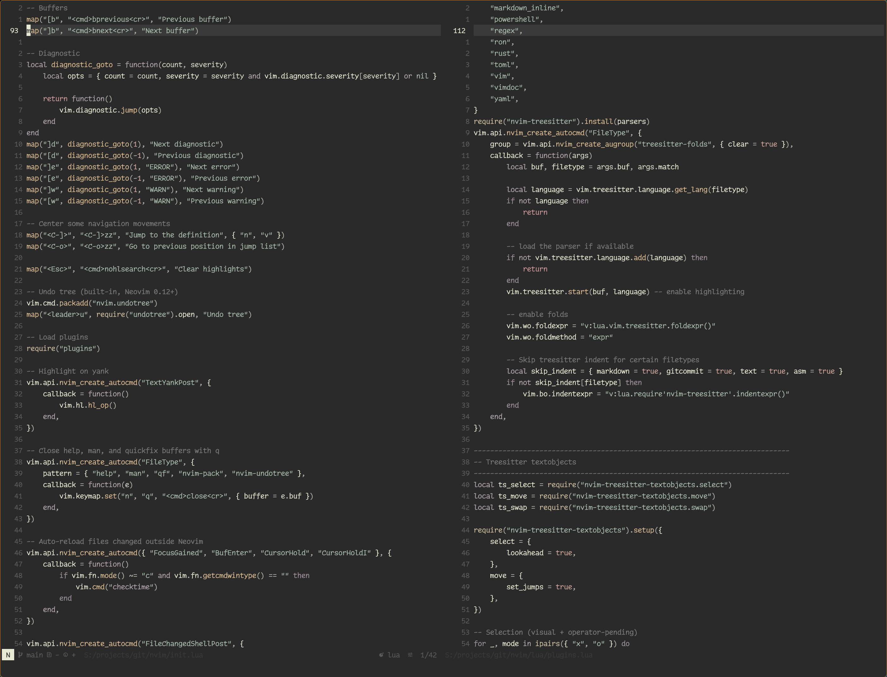

<h1>
  
  Haishoku
</h1>

<p align="center">
    A quiet Neovim color scheme. Accents and siblings distinguish syntax.<br>
    Inspired by <em>A Dictionary of Color Combinations</em> (配色総鑑).
</p>

<p align="center">
    
</p>

## Install

```lua
vim.pack.add({
  "https://github.com/freddiehaddad/haishoku.nvim",
})

vim.cmd.colorscheme("haishoku")
```

## Change the colors

Haishoku builds variety from pairs. Each accent has a nearby sibling:

```text
function  / library function
type      / builtin
string    / definition
constant  / return
keyword   / control flow
```
The palette is a plain Lua table. Change it before loading the scheme. Here is
[Catppuccin Mocha](https://github.com/catppuccin/catppuccin) translated into
Haishoku's accent-and-sibling grammar:

```lua
local palette = require("haishoku.palette")

palette.bg = "#1a1b26"
palette.bg_float = "#24283b"
palette.cursorline = "#292e42"
palette.fg = "#c0caf5"

-- Function: warm yellow / soft gold
palette.role_fn = "#e0af68"
palette.role_fn_lib = "#c9ae83"

-- Type: blue / muted blue
palette.role_type = "#7aa2f7"
palette.role_builtin = "#89a7d8"

-- String: green / soft teal
palette.role_string = "#9ece6a"
palette.role_def = "#73daca"

-- Constant: pink-red / muted rose
palette.role_const = "#f7768e"
palette.role_ret = "#d88b9d"

-- Keyword: purple / muted lavender
palette.role_keyword = "#bb9af7"
palette.role_kw_ctrl = "#9d7cd8"

vim.cmd.colorscheme("haishoku")
```

Change both colors in a pair. Their kinship keeps the scheme coherent, their
difference keeps the code legible.

For a full repaint, edit `lua/haishoku/palette.lua`. The rest of the scheme reads
from it.

## Per-language highlights & contributing

Haishoku's palette is language-agnostic, but the fine-grained categorization of a
language lives in two places:

- `after/queries/<lang>/` — treesitter query overrides.
- `lua/haishoku/highlight/<lang>.lua` — LSP semantic-token and capture mappings
  onto Haishoku's roles (see `lua/haishoku/highlight/asm.lua`,
  `lua/haishoku/highlight/c.lua`, `lua/haishoku/highlight/lua.lua` and
  `lua/haishoku/highlight/rust.lua`).

Assembly, C, Lua and Rust ship today. If you work in another language and the
LSP/treesitter data is rich enough to categorize well, two paths are both
welcome:

- **Local:** drop a `highlight/<lang>.lua` (and queries) in your own config to
  tune it for yourself — nothing needs to be upstreamed.
- **Upstream:** open a PR with the same for a language you actually use. Hand-
  tuned mappings from someone who reads that code daily are exactly what keeps
  the scheme coherent.
